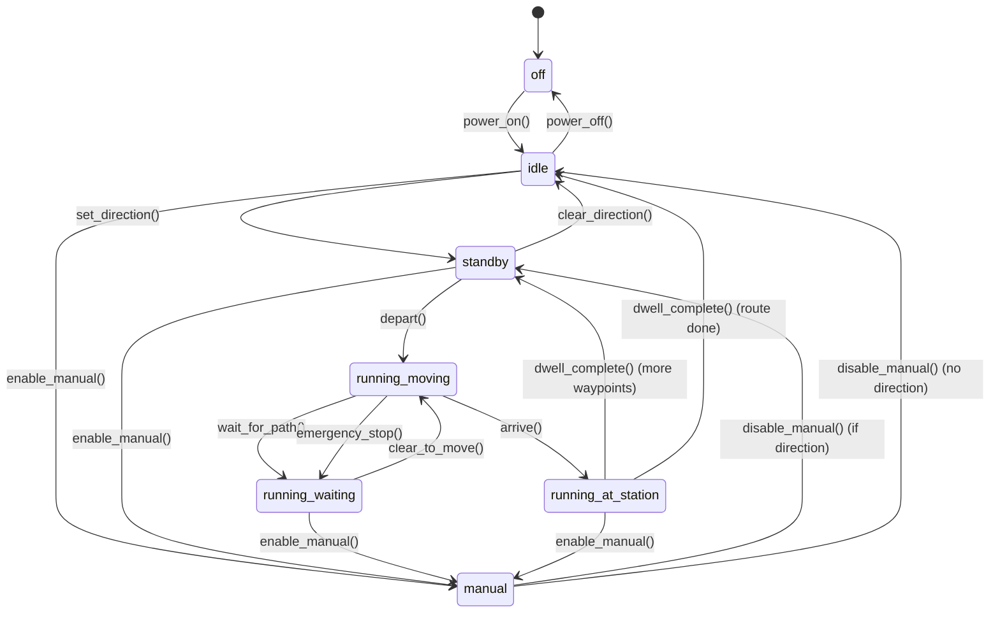

# Technical Specification: Train System

> **Document Type:** Technical Implementation Specification
> **Version:** 1.0
> **Created:** January 2026
> **Status:** Implemented

## Table of Contents

1. [Overview & Core Concepts](#1-overview--core-concepts)
2. [Entity Summary](#2-entity-summary)
3. [Entity Relationships](#3-entity-relationships)
4. [SpeedProfile Specification](#4-speedprofile-specification)
5. [Route & Waypoint Specification](#5-route--waypoint-specification)
6. [TrainATC Specification](#6-trainatc-specification)
7. [BlockPowerController Specification](#7-blockpowercontroller-specification)
8. [Train Class Modifications](#8-train-class-modifications)
9. [Block Class Modifications](#9-block-class-modifications)
10. [SimulationController Integration](#10-simulationcontroller-integration)
11. [Renaming Plan (Route → Path)](#11-renaming-plan-route--path)
12. [API Endpoints](#12-api-endpoints)
13. [State Machine Diagrams](#13-state-machine-diagrams)
14. [Example Scenarios](#14-example-scenarios)
15. [Implementation Phases](#15-implementation-phases)
16. [Configuration Constants](#16-configuration-constants)
17. [Future Considerations](#17-future-considerations)

---

## 1. Overview & Core Concepts

### 1.1 Purpose

This document specifies the Train System for the railway management platform, enabling:

- Train placement on tracks with multi-block occupancy based on length
- Directional movement (forward/reverse) with automatic turn-around at waypoints
- Route-based autonomous travel with waypoints and timing
- DC analog block control (voltage → speed mapping)
- Automatic Train Control (ATC) for safe speed regulation

### 1.2 Control Model: DC Analog Block Control

```
┌─────────────────────────────────────────────────────────────────┐
│                    DC ANALOG CONTROL MODEL                       │
│                                                                  │
│   Train ──► SpeedProfile ──► Voltage ──► BlockPowerController   │
│     │                                            │               │
│     │  "I want 60 km/h"    "Output 8V"          │               │
│     │                                            ▼               │
│     │                                    ┌─────────────┐         │
│     │                                    │   Block A   │ 8V      │
│     │                                    │   Block B   │ 8V      │
│     │                                    │   Block C   │ 0V      │
│     │                                    └─────────────┘         │
│     │                                            │               │
│     └────────── ATC ◄── "Clear distance: 200cm" ─┘               │
│                  │                                               │
│                  └─► Limits target speed based on clearance      │
└─────────────────────────────────────────────────────────────────┘
```

**Key Principle:** The train doesn't have power. The blocks output voltage, and the train's physical motors respond. The software controls block voltage based on what trains occupy them.

### 1.3 Units

| Measurement | Unit | Notes |
|-------------|------|-------|
| Speed | km/h | Scale speed (what the model represents) |
| Distance | cm | Centimeters (physical layout measurement) |
| Voltage | V (0-12) | DC voltage output to track |
| Time | seconds | For acceleration/deceleration rates |
| Acceleration | km/h/s | Speed change per second |

### 1.4 Key Design Decisions

| Decision | Choice | Rationale |
|----------|--------|-----------|
| Control Model | DC Analog | Each block has independent voltage |
| Naming | Path = infrastructure reservation, Route = train's travel plan | Clear separation of infrastructure vs operation |
| Turn-around | Automatic at waypoints | Model trains run both directions |
| Consist | Multi-car supports | Realistic length-based occupancy |
| Conflict Resolution | First-come-first-served via PathDispatcher | Proven interlocking logic |
| Train Placement | Tile (x,y) or Station placement | User flexibility |
| Block Occupancy | Multi-block (head to tail) | Safety for long trains |
| Facing Direction | Set on placement, system managed | Deterministic movement |
| Default SpeedProfile | Auto-created on startup | Ready-to-run experience |


---

## 2. Entity Summary

### 2.1 New Entities

| Entity | File | Purpose |
|--------|------|---------|
| `SpeedProfile` | `speed_profile.py` | Maps speed ↔ voltage, holds dynamics |
| `Route` | `train_route.py` | Train's travel plan with waypoints |
| `Waypoint` | `train_route.py` | Single stop in a Route |
| `TimingMode` | `train_route.py` | ABSOLUTE / RELATIVE / NONE |
| `RouteMode` | `train_route.py` | ONE_WAY / LOOP / ROUND_TRIP |
| `BlockPowerController` | `block_power.py` | Manages voltage output to blocks |
| `TrainATC` | `train_atc.py` | Automatic speed control |

### 2.2 Modified Entities

| Entity | Changes |
|--------|---------|
| `Train` | Add model, min_radius, directions, speed_profile, route |
| `Block` | Add voltage output capability |
| `SimulationController` | Integrate Route execution, ATC, voltage |

### 2.3 Renamed Entities (Route → Path)

| Current | New |
|---------|-----|
| `Route` (dispatcher) | `Path` |
| `RouteStatus` | `PathStatus` |

---

## 3. Entity Relationships

```
                                    ┌─────────────────────┐
                                    │   SpeedProfile      │
                                    │   ─────────────     │
                                    │   profile_id        │
                                    │   speed_voltage_map │
                                    │   accel_rate        │
                                    │   decel_rate        │
                                    │   emergency_rate    │
                                    └──────────┬──────────┘
                                               │
                                               │ has_profile
                                               ▼
┌──────────────┐      assigned_to      ┌─────────────────────┐
│    Route     │ ◄──────────────────── │       Train         │
│  ──────────  │                       │   ───────────       │
│  route_id    │                       │   train_id          │
│  waypoints[] │                       │   model             │
│  mode        │                       │   min_radius_cm     │
│  current_idx │                       │   facing_direction  │
└──────┬───────┘                       │   travel_direction  │
       │                               │   current_speed     │
       │ contains                      │   target_speed      │
       ▼                               └──────────┬──────────┘
┌──────────────┐                                  │
│   Waypoint   │                                  │ occupies (based on length)
│  ──────────  │                                  ▼
│  station_id  │                       ┌─────────────────────┐
│  dwell_time  │                       │      Block          │
│  timing_mode │                       │   ───────────       │
│  target_time │                       │   block_id          │
└──────────────┘                       │   current_voltage   │
                                       │   occupied_by       │
       ┌───────────────────────────────┤   length_cm         │
       │                               └─────────────────────┘
       │ controls voltage                        ▲
       ▼                                         │
┌──────────────────────┐                         │ monitors
│ BlockPowerController │                         │
│ ──────────────────── │               ┌─────────────────────┐
│ set_block_voltage()  │               │     TrainATC        │
│ get_block_voltage()  │               │   ───────────       │
│ output_interface     │ ◄──────────── │   get_clearance()   │
└──────────────────────┘   commands    │   calculate_limit() │
                                       └─────────────────────┘
```

---

## 4. SpeedProfile Specification

### 4.1 Purpose

Maps a train's target speed (km/h) to the voltage that should be output to the blocks it occupies. Each train model has unique motor characteristics.

### 4.2 Properties

| Property | Type | Required | Default | Description |
|----------|------|----------|---------|-------------|
| `profile_id` | `str` | Yes | Auto | Unique identifier |
| `name` | `str` | Yes | - | Display name (e.g., "HO Generic", "N Scale Slow") |
| `speed_voltage_curve` | `List[Tuple[float, float]]` | Yes | - | List of (speed_kmh, voltage) calibration points |
| `min_start_voltage` | `float` | No | 2.0 | Minimum voltage to overcome static friction |
| `lighting_voltage` | `float` | No | 2.5 | Voltage for lights without movement (IDLE/STANDBY states) |
| `acceleration_rate` | `float` | Yes | 10.0 | Speed increase rate (km/h per second) |
| `deceleration_rate` | `float` | Yes | 15.0 | Service brake rate (km/h per second) |
| `emergency_brake_rate` | `float` | Yes | 30.0 | Emergency brake rate (km/h per second) |

### 4.3 Speed-Voltage Curve

The curve is defined as calibration points. The system interpolates between points.

```python
# Example: HO Scale Generic Profile
speed_voltage_curve = [
    (0.0, 0.0),      # Stopped
    (10.0, 3.0),     # 10 km/h requires 3V
    (30.0, 5.0),     # 30 km/h requires 5V
    (60.0, 8.0),     # 60 km/h requires 8V
    (100.0, 11.0),   # 100 km/h requires 11V
    (120.0, 12.0),   # Max speed at max voltage
]
```

### 4.4 Class Definition

```python
@dataclass
class SpeedProfile:
    """Maps target speed to voltage output for DC analog control."""
    
    profile_id: str
    name: str
    speed_voltage_curve: List[Tuple[float, float]]  # [(speed_kmh, voltage), ...]
    
    min_start_voltage: float = 2.0  # Voltage to overcome static friction
    lighting_voltage: float = 2.5  # Voltage for lights without movement
    acceleration_rate: float = 10.0  # km/h per second
    deceleration_rate: float = 15.0  # km/h per second (service brake)
    emergency_brake_rate: float = 30.0  # km/h per second
    
    def speed_to_voltage(self, speed_kmh: float) -> float:
        """Convert target speed to required voltage (interpolated)."""
        ...
    
    def voltage_to_speed(self, voltage: float) -> float:
        """Convert voltage to expected speed (interpolated)."""
        ...
    
    def calculate_new_speed(
        self, 
        current_speed: float, 
        target_speed: float, 
        delta_time: float,
        is_emergency: bool = False
    ) -> float:
        """Calculate speed after delta_time given acceleration/deceleration."""
        ...
    
    def to_dict(self) -> Dict[str, Any]: ...
    
    @classmethod
    def from_dict(cls, data: Dict[str, Any]) -> 'SpeedProfile': ...
```

### 4.5 Calibration UI (Future)

> **TODO:** Add a button/wizard in the UI to calibrate speed-voltage curve with physical measurements. User would:
> 1. Set voltage manually
> 2. Measure actual speed (timing over known distance)
> 3. Record data point
> 4. Repeat for multiple voltages
> 5. System generates curve

---

## 5. Route & Waypoint Specification

### 5.1 Purpose

A `Route` is the train's travel plan - a sequence of waypoints (stations) the train will visit autonomously. This is distinct from the dispatcher's `Path` (infrastructure reservation).

### 5.2 Route Properties

| Property | Type | Required | Default | Description |
|----------|------|----------|---------|-------------|
| `route_id` | `str` | Yes | Auto | Unique identifier |
| `name` | `str` | No | "" | Display name |
| `waypoints` | `List[Waypoint]` | Yes | [] | Ordered list of stops |
| `mode` | `RouteMode` | No | ONE_WAY | How to traverse waypoints |
| `current_waypoint_index` | `int` | No | 0 | Current position in waypoints |
| `is_active` | `bool` | No | False | Whether route is being executed |
| `direction` | `int` | No | 1 | +1 = forward through list, -1 = reverse (for ROUND_TRIP) |
| `last_error` | `Optional[str]` | No | None | Last error message (if path not found, etc.) |
| `error_time` | `Optional[float]` | No | None | Simulation time when error occurred |

### 5.3 RouteMode Enum

| Value | Behavior | Example (waypoints: A, B, C) |
|-------|----------|------------------------------|
| `ONE_WAY` | Visit once, then stop | A → B → C → (done) |
| `LOOP` | Return to start, repeat | A → B → C → A → B → C → ... |
| `ROUND_TRIP` | Reverse at ends, repeat | A → B → C → B → A → B → C → ... |

### 5.4 Waypoint Properties

| Property | Type | Required | Default | Description |
|----------|------|----------|---------|-------------|
| `station_id` | `str` | Yes | - | Target station ID |
| `dwell_time_sec` | `float` | No | 30.0 | Default stop duration |
| `timing_mode` | `TimingMode` | No | NONE | How timing is applied |
| `target_time` | `Optional[float]` | No | None | For ABSOLUTE/RELATIVE modes |

### 5.5 TimingMode Enum

| Value | Description | `target_time` meaning |
|-------|-------------|----------------------|
| `NONE` | No timing constraint | Ignored; depart after dwell_time |
| `RELATIVE` | Relative to route start | Seconds since route activation |
| `ABSOLUTE` | Synchronized time | Simulation clock time |

### 5.6 Automatic Turn-Around (Cab Switch Model)

When a train arrives at a waypoint and needs to travel in the opposite direction to reach the next waypoint, the system automatically calls `train.turn_around()`. This works like switching cabs in a real train:

**Cab Switch Behavior:**
- `facing_direction` **flips** to the new direction (like the driver moving to the other cab)
- `travel_direction` stays `'forward'` (train always moves "forward" relative to active cab)

**Example:**
```
BEFORE turn_around():
  facing_direction = WEST
  travel_direction = 'forward'
  → Train moves WEST

AFTER turn_around():
  facing_direction = EAST  (flipped!)
  travel_direction = 'forward'  (unchanged)
  → Train moves EAST
```

**Note:** `travel_direction` is only used in MANUAL mode when the user wants to drive in reverse.

### 5.7 Class Definitions

```python
class TimingMode(Enum):
    NONE = "none"           # No timing, just dwell
    RELATIVE = "relative"   # Time since route started
    ABSOLUTE = "absolute"   # Synchronized simulation time

class RouteMode(Enum):
    ONE_WAY = "one_way"         # A → B → C → stop
    LOOP = "loop"               # A → B → C → A → B → C → ...
    ROUND_TRIP = "round_trip"   # A → B → C → B → A → B → ...

@dataclass
class Waypoint:
    """Single stop in a train's Route."""
    
    station_id: str
    dwell_time_sec: float = 30.0
    timing_mode: TimingMode = TimingMode.NONE
    target_time: Optional[float] = None  # Meaning depends on timing_mode
    
    def should_depart(
        self, 
        time_at_station: float, 
        route_start_time: float,
        simulation_time: float
    ) -> bool:
        """Determine if train should depart based on timing mode."""
        if self.timing_mode == TimingMode.NONE:
            return time_at_station >= self.dwell_time_sec
        elif self.timing_mode == TimingMode.RELATIVE:
            elapsed = simulation_time - route_start_time
            return elapsed >= self.target_time
        elif self.timing_mode == TimingMode.ABSOLUTE:
            return simulation_time >= self.target_time
        return False
    
    def to_dict(self) -> Dict[str, Any]: ...
    
    @classmethod
    def from_dict(cls, data: Dict[str, Any]) -> 'Waypoint': ...

@dataclass
class Route:
    """Train's travel plan - sequence of waypoints to visit."""
    
    route_id: str
    name: str = ""
    waypoints: List[Waypoint] = field(default_factory=list)
    mode: RouteMode = RouteMode.ONE_WAY
    
    # Execution state
    current_waypoint_index: int = 0
    direction: int = 1  # +1 forward, -1 reverse (for ROUND_TRIP)
    is_active: bool = False
    started_at: Optional[float] = None  # Simulation time when activated
    
    def get_current_waypoint(self) -> Optional[Waypoint]:
        """Get the current target waypoint."""
        if 0 <= self.current_waypoint_index < len(self.waypoints):
            return self.waypoints[self.current_waypoint_index]
        return None
    
    def advance_to_next_waypoint(self) -> Optional[Waypoint]:
        """
        Move to next waypoint based on mode. 
        Returns new waypoint or None if done.
        """
        if self.mode == RouteMode.ONE_WAY:
            self.current_waypoint_index += 1
            if self.current_waypoint_index >= len(self.waypoints):
                return None  # Route complete
        
        elif self.mode == RouteMode.LOOP:
            self.current_waypoint_index += 1
            if self.current_waypoint_index >= len(self.waypoints):
                self.current_waypoint_index = 0  # Wrap around
        
        elif self.mode == RouteMode.ROUND_TRIP:
            self.current_waypoint_index += self.direction
            if self.current_waypoint_index >= len(self.waypoints):
                self.direction = -1
                self.current_waypoint_index = len(self.waypoints) - 2
            elif self.current_waypoint_index < 0:
                self.direction = 1
                self.current_waypoint_index = 1
        
        return self.get_current_waypoint()
    
    def is_complete(self) -> bool:
        """Check if route has completed (ONE_WAY only)."""
        if self.mode != RouteMode.ONE_WAY:
            return False
        return self.current_waypoint_index >= len(self.waypoints)
    
    def get_next_station_id(self) -> Optional[str]:
        """Get the next station the train should travel to."""
        waypoint = self.get_current_waypoint()
        return waypoint.station_id if waypoint else None
    
    def to_dict(self) -> Dict[str, Any]: ...
    
    @classmethod
    def from_dict(cls, data: Dict[str, Any]) -> 'Route': ...
```

---

## 6. TrainATC Specification

### 6.1 Purpose

Automatic Train Control (ATC) limits train speed based on the available clearance ahead. It prevents collisions by calculating safe braking curves.

### 6.2 Core Algorithm

```
1. Get train's current position and direction
2. Follow the route/path forward, summing block distances
3. Stop summing when hitting:
   - A block occupied by another train
   - A block not reserved for this train's path
   - A red signal
4. Calculate the maximum safe speed for that clearance distance
5. Return min(train_max_speed, route_speed_limit, safe_speed)
```

### 6.3 Braking Curve Calculation

```python
def calculate_max_safe_speed(
    clearance_cm: float, 
    deceleration_rate: float,  # km/h per second
    safety_margin_cm: float = 50.0
) -> float:
    """
    Calculate maximum speed that allows stopping within clearance.
    
    Physics: v² = 2 * a * d
    Where:
        v = velocity (must convert km/h ↔ cm/s)
        a = deceleration (km/h/s → cm/s²)
        d = distance (cm)
    
    Args:
        clearance_cm: Available distance before obstruction
        deceleration_rate: Braking rate in km/h per second
        safety_margin_cm: Buffer distance (default 50cm)
    
    Returns:
        Maximum safe speed in km/h
    """
    effective_distance = max(0, clearance_cm - safety_margin_cm)
    
    # Convert deceleration from km/h/s to cm/s²
    # 1 km/h = 100000/3600 cm/s ≈ 27.78 cm/s
    # So km/h/s to cm/s² = multiply by 27.78
    decel_cm_s2 = deceleration_rate * (100000 / 3600)
    
    # v² = 2 * a * d
    v_cm_s_squared = 2 * decel_cm_s2 * effective_distance
    v_cm_s = math.sqrt(v_cm_s_squared) if v_cm_s_squared > 0 else 0
    
    # Convert back to km/h
    v_kmh = v_cm_s * 3600 / 100000
    
    return v_kmh
```

### 6.4 Class Definition

```python
@dataclass
class TrainATC:
    """Automatic Train Control - limits speed based on clearance."""
    
    train: 'Train'
    network: 'RailwayNetwork'
    
    # Configuration
    safety_margin_cm: float = 50.0  # Buffer before obstruction
    signal_lookahead_blocks: int = 3  # How many blocks to check signals
    
    def get_clearance_ahead(self) -> float:
        """
        Calculate available clearance in cm.
        
        Follows the train's current path forward, summing block lengths
        until hitting an obstruction (occupied block, red signal, end of path).
        
        Returns:
            Distance in cm until next obstruction
        """
        clearance = 0.0
        
        # Start from train's current position
        current_block = self._get_current_block()
        if not current_block:
            return 0.0
        
        # Add remaining distance in current block
        clearance += self._get_remaining_distance_in_block()
        
        # Follow path forward
        for block_id in self._get_blocks_ahead():
            block = self.network.blocks.get(block_id)
            if not block:
                break
            
            # Check if block is clear
            if block.state == BlockState.OCCUPIED:
                if block.occupied_by != self.train.train_id:
                    break  # Another train ahead
            
            # Check signals
            if self._is_signal_red_for_block(block_id):
                break
            
            clearance += block.length_cm
        
        return clearance
    
    def get_speed_limit(self) -> float:
        """
        Get the current ATC speed limit.
        
        Considers:
        - Clearance ahead (braking curve)
        - Block speed limits
        - Signal aspects (YELLOW = caution speed)
        
        Returns:
            Maximum allowed speed in km/h
        """
        clearance = self.get_clearance_ahead()
        profile = self._get_speed_profile()
        
        # Calculate max speed for braking curve
        safe_speed = calculate_max_safe_speed(
            clearance,
            profile.deceleration_rate,
            self.safety_margin_cm
        )
        
        # Check for yellow signals (caution speed)
        if self._is_approaching_yellow_signal():
            safe_speed = min(safe_speed, YELLOW_SIGNAL_SPEED_KMH)
        
        # Check block speed limits
        block_limit = self._get_current_block_speed_limit()
        
        return min(safe_speed, block_limit)
    
    def get_target_speed(self) -> float:
        """
        Get the target speed for the train.
        
        Returns min of:
        - Train's max_speed
        - Current block's speed limit
        - ATC calculated limit
        """
        return min(
            self.train.max_speed,
            self.get_speed_limit()
        )
```

---

## 7. BlockPowerController Specification

### 7.1 Purpose

Manages voltage output to track blocks. In DC analog control, each block is electrically isolated and receives independent voltage.

### 7.2 Architecture

```
┌────────────────────────────────────────────────────────────┐
│                   BlockPowerController                      │
│                                                            │
│   ┌──────────────────┐    ┌──────────────────┐            │
│   │  Block Voltage   │    │  Output Interface │            │
│   │  Registry        │    │  (Abstract)       │            │
│   │  ────────────    │    │  ─────────────    │            │
│   │  BLK_001: 8.0V   │───►│  set_voltage()   │───► [HW]   │
│   │  BLK_002: 8.0V   │    │  get_voltage()   │            │
│   │  BLK_003: 0.0V   │    └──────────────────┘            │
│   └──────────────────┘                                     │
│                                                            │
│   Methods:                                                 │
│   - update_for_train(train) → set all occupied blocks     │
│   - emergency_stop_all() → set all to 0V                  │
│   - get_block_voltage(block_id) → current voltage         │
└────────────────────────────────────────────────────────────┘
```

### 7.3 Output Interface (Abstract)

The `OutputInterface` is an abstract class that will be implemented for:
- **Simulation:** Just stores values in memory
- **Hardware (Future):** Serial/I2C/GPIO to physical controllers

```python
class OutputInterface(ABC):
    """Abstract interface for hardware voltage output."""
    
    @abstractmethod
    def set_voltage(self, block_id: str, voltage: float) -> bool:
        """Output voltage to a block. Returns success."""
        pass
    
    @abstractmethod
    def get_actual_voltage(self, block_id: str) -> float:
        """Read actual voltage (for feedback). Returns voltage."""
        pass

class SimulatedOutputInterface(OutputInterface):
    """Simulated output - just stores values for simulation."""
    
    def __init__(self):
        self._voltages: Dict[str, float] = {}
    
    def set_voltage(self, block_id: str, voltage: float) -> bool:
        self._voltages[block_id] = voltage
        return True
    
    def get_actual_voltage(self, block_id: str) -> float:
        return self._voltages.get(block_id, 0.0)
```

### 7.4 Class Definition

```python
@dataclass
class BlockPowerController:
    """Manages DC voltage output to track blocks."""
    
    network: 'RailwayNetwork'
    output_interface: OutputInterface = field(default_factory=SimulatedOutputInterface)
    
    # Voltage limits
    max_voltage: float = 12.0
    min_voltage: float = 0.0
    
    def update_for_train(self, train: 'Train') -> None:
        """
        Update voltage for all blocks occupied by this train.
        
        Uses train's SpeedProfile to convert target_speed to voltage.
        """
        profile = self._get_speed_profile(train)
        voltage = profile.speed_to_voltage(train.target_speed)
        
        for block_id in train.get_occupied_blocks():
            self.set_block_voltage(block_id, voltage)
    
    def set_block_voltage(self, block_id: str, voltage: float) -> bool:
        """Set voltage for a specific block."""
        clamped = max(self.min_voltage, min(self.max_voltage, voltage))
        
        # Update block's stored voltage
        block = self.network.blocks.get(block_id)
        if block:
            block.current_voltage = clamped
        
        return self.output_interface.set_voltage(block_id, clamped)
    
    def get_block_voltage(self, block_id: str) -> float:
        """Get current voltage for a block."""
        return self.output_interface.get_actual_voltage(block_id)
    
    def emergency_stop_all(self) -> None:
        """Set all blocks to 0V immediately."""
        for block_id in self.network.blocks:
            self.set_block_voltage(block_id, 0.0)
    
    def release_block(self, block_id: str) -> None:
        """Set block to 0V (no train occupying)."""
        self.set_block_voltage(block_id, 0.0)
    
    def to_dict(self) -> Dict[str, Any]:
        """Serialize current voltage state."""
        return {
            block_id: self.get_block_voltage(block_id)
            for block_id in self.network.blocks
        }
```

---

## 8. Train Class Modifications

### 8.1 Train State Enum

The `TrainState` enum is the primary state for DC analog control, providing granular control over voltage and lighting.

| State | Internal Value | Voltage | Polarity | Lights | Description |
|-------|----------------|---------|----------|--------|-------------|
| **off** | `off` | 0V | None | None | Train shut off |
| **idle** | `idle` | Lighting | Opposite* | Red Ends | Powered, no direction |
| **standby** | `standby` | Lighting | Normal | H+T | Direction set, ready |
| **running_moving** | `running_moving` | Speed-based | Normal | H+T | Actively moving |
| **running_waiting** | `running_waiting` | Lighting | Normal | H+T | Stopped waiting for path/signal |
| **running_at_station** | `running_at_station` | Lighting | Normal | H+T | Dwelling at station |
| **manual** | `manual` | Manual | Normal | Directional| User controlled speed |

*\*Opposite polarity for red lights both ends is only applied if multi-block occupancy safety checks pass.*

### 8.2 State Transitions




### 8.2 State Definitions

| State | Voltage | Block Polarity | Lights | Description |
|-------|---------|----------------|--------|-------------|
| **OFF** | 0V | None | None | Train shut off |
| **IDLE** | Lighting | Opposite (if ≥2 blocks & safe) | Red both ends | Powered, no destination |
| **STANDBY** | Lighting | Same across blocks | Headlight + taillight | Direction set, ready to depart |
| **RUNNING_MOVING** | Speed-based | Same | Headlight + taillight | Actively moving |
| **RUNNING_WAITING** | Lighting | Same | Headlight + taillight | Stopped, waiting for path/signal |
| **RUNNING_AT_STATION** | Lighting | Same | Headlight + taillight | Dwelling at station |
| **MANUAL** | User-controlled | Same | Based on direction | User controls speed, ATC protects |

### 8.3 State Transitions

```
                                    ┌─────────────────────────────────────────┐
                                    │            RUNNING (group)              │
                                    │  ┌─────────┐ ┌─────────┐ ┌───────────┐  │
                                    │  │ MOVING  │ │ WAITING │ │ AT_STATION│  │
                                    │  │ (speed) │ │(lighting)│ │(lighting) │  │
                                    │  └─────────┘ └─────────┘ └───────────┘  │
                                    └──────────────────┬──────────────────────┘
                                                       ▲
                                          depart()     │     arrive()
                                                       │
┌───────────────────┐              ┌───────────────────┴───────────────────┐
│      MANUAL       │◄────────────►│               STANDBY                  │
│  User controls    │   (toggle    │  Direction set, lighting voltage       │
│  ATC protects     │   when       │  Headlight forward, taillight rear     │
│  Route in bg      │   stopped)   └───────────────────┬───────────────────┘
└───────────────────┘                                  ▲
                                      set_direction()  │  arrive() + route complete
                                      or assign_route()│  → unassign route → IDLE
                                                       │
                                    ┌──────────────────┴───────────────────┐
                                    │                IDLE                   │
                                    │  Powered, no destination, lighting V  │
                                    │  If ≥2 blocks & safe: red both ends   │
                                    │  Else: keep last polarity             │
                                    └──────────────────┬───────────────────┘
                                                       ▲
                                          power_on()   │   power_off()
                                                       │
                                    ┌──────────────────┴───────────────────┐
                                    │                 OFF                   │
                                    │  0V, no lights                        │
                                    └──────────────────────────────────────┘
```

### 8.4 MANUAL State Details

| Aspect | Behavior |
|--------|----------|
| **Entry** | Only when train is stopped (from IDLE or STANDBY) |
| **Speed Control** | User sets target speed manually (slider/input) |
| **ATC Protection** | ATC still limits speed based on clearance (user cannot exceed) |
| **Path Usage** | User can request paths via dispatcher |
| **Route in Background** | Route continues tracking, auto-advances at waypoints |
| **`travel_direction`** | User can set to 'reverse' to drive backward |
| **Exit** | Returns to previous state (IDLE or STANDBY) when toggled off |

### 8.5 IDLE State - Opposite Polarity for Red Lights

When in IDLE state with ≥2 blocks, the system can output opposite polarity to show red lights on both ends. However, this requires safety checks:

```python
def is_opposite_polarity_safe(train: Train, network: RailwayNetwork) -> bool:
    """
    Check if opposite polarity is safe (no car bridges block boundaries).
    
    If ANY car spans two blocks, opposite polarity would cause short circuit.
    """
    occupied_blocks = train.get_occupied_blocks()
    
    if len(occupied_blocks) < 2:
        return False  # Need ≥2 blocks for opposite polarity
    
    # Check each car's position
    for car_position in train.get_car_positions():
        car_start_block = get_block_at(car_position.start)
        car_end_block = get_block_at(car_position.end)
        
        if car_start_block != car_end_block:
            return False  # Car bridges two blocks - NOT SAFE
    
    return True  # All cars are within single blocks

def get_idle_polarity(train: Train, network: RailwayNetwork) -> str:
    """Determine polarity for IDLE state blocks."""
    if is_opposite_polarity_safe(train, network):
        return "opposite"  # Red lights on both ends
    else:
        return "same"  # Keep last polarity, one-sided lights
```

### 8.6 New Properties

| Property | Type | Default | Description |
|----------|------|---------|-------------|
| `model` | `str` | "" | Train model name (e.g., "BR 218", "Shinkansen E5") |
| `min_radius_cm` | `float` | 30.0 | Minimum curve radius train can navigate |
| `facing_direction` | `Direction` | None | Which cab is active (flips on turn-around) |
| `travel_direction` | `Literal['forward', 'reverse']` | 'forward' | Only for MANUAL mode reverse driving |
| `state` | `TrainState` | OFF | Current power/operational state |
| `speed_profile_id` | `Optional[str]` | None | SpeedProfile for this train (uses DEFAULT if None) |
| `assigned_route_id` | `Optional[str]` | None | Route (travel plan) assigned to train |
| `target_speed` | `float` | 0.0 | ATC-limited target speed |
| `manual_target_speed` | `float` | 0.0 | User-set speed in MANUAL mode |

### 8.2 Train Placement

Trains can be placed in two ways:

**1. Tile Placement (x, y coordinates):**
- User selects a track tile
- System shows valid facing directions based on track bits (edges with paths)
- User picks one of the valid directions
- Train is placed at that tile with specified facing direction

**2. Station Placement:**
- User selects a station
- System determines track orientation from station data
- User picks facing direction from valid options
- Train is placed at a station tile, occupying appropriate blocks

**Facing Direction Rules:**
- On initial placement: User must choose from track-valid options
- After movement: System updates facing_direction to match last movement direction
- Turn-around: Flips `facing_direction` (cab switch), not `travel_direction`

```python
def get_valid_facing_directions(track: TrackSegment) -> List[Direction]:
    """Get valid facing directions based on track geometry."""
    valid = []
    for direction in [Direction.NORTH, Direction.EAST, Direction.SOUTH, Direction.WEST]:
        edge = direction.name[0]  # 'N', 'E', 'S', 'W'
        if track.has_exit(edge):
            valid.append(direction)
    return valid
```

### 8.7 New Methods

```python
def turn_around(self) -> bool:
    """
    Flip facing direction (cab switch). Only allowed when stopped.
    
    This is like the driver switching to the other cab in a real train.
    The train now faces the opposite direction.
    
    Note: travel_direction stays 'forward' - only used in MANUAL mode
    for explicit reverse driving.
    
    Returns:
        True if successful, False if train is moving
    """
    if self.current_speed > STOPPED_SPEED_THRESHOLD_KMH:
        return False
    
    # Flip facing direction (cab switch)
    self.facing_direction = OPPOSITE_DIRECTIONS[self.facing_direction]
    
    return True

def get_effective_direction(self) -> Direction:
    """
    Get actual movement direction considering facing and travel.
    
    In normal operation (travel_direction='forward'), this equals facing_direction.
    In MANUAL reverse mode, this is the opposite of facing_direction.
    """
    if self.travel_direction == 'forward':
        return self.facing_direction
    else:
        return OPPOSITE_DIRECTIONS[self.facing_direction]
```

### 8.7.1 TrainPosition System (New)

The `TrainPosition` dataclass tracks both ends of a train independently for accurate visualization and multi-tile occupancy:

```python
@dataclass
class TrainPosition:
    """
    Precise position tracking for both ends of a train.
    
    Design Goals:
    - Track head (end_a) and tail (end_b) independently
    - Support trains spanning multiple tiles
    - Enable accurate visualization on each occupied tile
    - Handle reversal by swapping leading_end
    """
    # End A position (typically the head when moving forward)
    end_a_tile: Tuple[int, int]        # (x, y) tile coordinates
    end_a_distance_cm: float           # Distance from entry edge (cm)
    end_a_entry_edge: str              # Edge where this end entered ('N','E','S','W')
    
    # End B position (typically the tail when moving forward)
    end_b_tile: Tuple[int, int]
    end_b_distance_cm: float
    end_b_entry_edge: str
    
    # Which end is leading (swaps on reverse)
    leading_end: str = "a"             # "a" or "b"
    
    # Direction train is facing
    facing_direction: Direction = None
    
    # Computed from position
    occupied_tiles: List[Tuple[int, int]] = None
    occupied_blocks: List[str] = None
```

**Key Concepts:**

1. **Head/Tail vs End A/B**: 
   - `head_tile` and `tail_tile` are properties that delegate to the appropriate end based on `leading_end`
   - When train reverses, `leading_end` swaps from "a" to "b" - the physical positions don't change

2. **Entry Edge**:
   - Each end has an `entry_edge` indicating which edge of the tile it entered from
   - Used to calculate exit edge and draw the train correctly along track geometry

3. **Distance from Entry**:
   - `distance_cm` is measured from the entry edge of that tile
   - For head: typically near tile_length (at exit edge)
   - For tail: distance from entry edge to where tail stops

**Backward Compatibility:**

The Train class provides legacy properties that auto-sync with TrainPosition:

```python
@property
def current_pos(self) -> Optional[Tuple[int, int]]:
    """Get current head position (tile coordinates)."""
    if self.position:
        return self.position.head_tile
    return self._current_pos

@current_pos.setter
def current_pos(self, value: Optional[Tuple[int, int]]):
    """Set current position (updates both legacy and new position system)."""
    self._current_pos = value
    if self.position and value:
        self.position.end_a_tile = value
```

**Frontend Data Format:**

The `to_dict()` method outputs two position formats:

```python
{
    # New format - full TrainPosition data
    "position": {
        "end_a": {"tile": [0, 0], "distance_cm": 50.0, "entry_edge": "W"},
        "end_b": {"tile": [0, 0], "distance_cm": 10.0, "entry_edge": "W"},
        "leading_end": "a",
        "facing_direction": "EAST",
        "occupied_tiles": [[0, 0]],
        "occupied_blocks": ["BLOCK_1"]
    },
    
    # Legacy format - for backward compatible frontend
    "position_legacy": {
        "x": 0, "y": 0,
        "distance": 1.0,  # 0-1 ratio for frontend interpolation
        "tile_length_cm": 50.0,
        "entry_edge": "W",
        "exit_edge": "E"
    },
    
    # Rich tile data for rendering train on each occupied tile
    "occupied_tiles_rich": [
        {
            "tile": [0, 0],
            "block_id": "BLOCK_1",
            "segment_start_cm": 10.0,
            "segment_end_cm": 50.0,
            "tile_length_cm": 50.0
        }
    ]
}
```

**Usage in place_train:**

```python
def place_train(self, train, tile_x, tile_y, direction):
    """Place train with full TrainPosition tracking."""
    # Calculate where tail ends up by tracing backward
    (occupied_tiles, tail_tile, tail_distance, tail_entry) = \
        self._calculate_occupied_tiles(
            head_tile=(tile_x, tile_y),
            head_distance_cm=tile_length_cm,  # Head at exit edge
            head_entry_edge=entry_edge,
            train_length_cm=train.length_cm
        )
    
    # Create TrainPosition with both ends tracked
    train.position = TrainPosition(
        end_a_tile=(tile_x, tile_y),
        end_a_distance_cm=tile_length_cm,
        end_a_entry_edge=entry_edge,
        end_b_tile=tail_tile,
        end_b_distance_cm=tail_distance,
        end_b_entry_edge=tail_entry,
        leading_end="a",
        facing_direction=direction,
        occupied_tiles=occupied_tiles,
        occupied_blocks=occupied_blocks
    )
```

```python
def get_occupied_blocks(self) -> List[str]:
    """
    Get all blocks this train occupies based on its length.
    
    Traces back from head position along the path for train.length distance.
    
    Returns:
        List of block IDs from head to tail
    """
    occupied = []
    remaining_length = self.length * 100  # Convert to cm
    
    # Start at head position
    current_pos = self.current_pos
    
    while remaining_length > 0 and current_pos:
        block_id = self._get_block_at_position(current_pos)
        if block_id and block_id not in occupied:
            occupied.append(block_id)
        
        # Move backward along path
        current_pos = self._get_previous_position(current_pos)
        remaining_length -= self._get_track_length_at(current_pos)
    
    return occupied

def update_block_occupancy(self, network: 'RailwayNetwork') -> None:
    """
    Update which blocks this train occupies based on position and length.
    
    - Occupy new blocks as head enters
    - Release old blocks as tail exits
    """
    new_occupied = set(self.get_occupied_blocks())
    old_occupied = set(self.occupied_blocks) if hasattr(self, 'occupied_blocks') else set()
    
    # Occupy new blocks
    for block_id in new_occupied - old_occupied:
        network.block_manager.occupy_block(block_id, self.train_id)
    
    # Release old blocks
    for block_id in old_occupied - new_occupied:
        network.block_manager.clear_block(block_id)
    
    self.occupied_blocks = list(new_occupied)
```

### 8.8 Updated to_dict

Add serialization for new properties. `to_dict` requires the `network` object to calculate distance ratios for the frontend:

```python
def to_dict(self, network=None) -> dict:
    data = {
        # ... existing fields ...
        "model": self.model,
        "min_radius_cm": self.min_radius_cm,
        "facing_direction": self.facing_direction.name if self.facing_direction else None,
        "travel_direction": self.travel_direction,
        "state": self.state.value,
        "speed_profile_id": self.speed_profile_id,
        "assigned_route_id": self.assigned_route_id,
        "target_speed": self.target_speed,
        "manual_target_speed": self.manual_target_speed,
    }
    
    # New TrainPosition format (contains both ends)
    if self.position:
        data["position"] = self.position.to_dict()
        if network and hasattr(network, "get_occupied_tiles_rich"):
            data["occupied_tiles_rich"] = network.get_occupied_tiles_rich(self)
    
    # Legacy position format (for backward compatible frontends)
    if self.current_pos:
        tile_length_cm = network._get_tile_length_cm(*self.current_pos) if network else 0.0
        distance_ratio = self.distance_on_track / tile_length_cm if tile_length_cm > 0 else 0.0
        data["position_legacy"] = {
            "x": self.current_pos[0],
            "y": self.current_pos[1],
            "distance": distance_ratio,  # 0.0-1.0 for frontend interpolation
            "tile_length_cm": tile_length_cm,
            "entry_edge": ...,  # Calculated from direction
            "exit_edge": ...
        }
        
    return data
```

### 8.9 Notes on Units

- `distance_on_track` is stored in **centimeters (cm)** from the entry edge.
- `length` is defined in meters, but occupancy calculation converts it to cm.
- The frontend receives a `distance` ratio (0.0 to 1.0) for smooth interpolation between tiles.
- Use `train_config.kmh_to_cm_per_sec()` for physics calculations.

### 8.10 Error Handling: Path Not Found

When a train's Route cannot find a Path to the next waypoint:

1. **Train stops** at current position (target_speed = 0)
2. **Error is logged** with details (train_id, current position, target station)
3. **Train state** set to `RUNNING_WAITING` (waiting for manual intervention)
4. **Route remains active** but paused - can retry when path becomes available
5. **UI displays error** to operator

```python
def _dispatch_to_station(self, train: Train, station_id: str) -> bool:
    """Request a path to the target station."""
    station = self.network.stations.get(station_id)
    if not station:
        self._set_route_error(train, f"Station {station_id} not found")
        return False
    
    # Try to create path via PathDispatcher
    result = self.path_dispatcher.create_path(
        start_block_id=train.current_block_id,
        end_station_id=station_id,
        train_id=train.train_id
    )
    
    if not result.success:
        self._set_route_error(train, f"No path to {station_id}: {result.error}")
        train.target_speed = 0
        train.state = TrainState.RUNNING_WAITING
        return False
    
    train.assigned_path_id = result.path.path_id
    train.state = TrainState.RUNNING_MOVING
    return True

def _set_route_error(self, train: Train, message: str):
    """Record route execution error."""
    logger.error(f"[Route Error] Train {train.train_id}: {message}")
    # Store error for UI display
    route = self.routes.get(train.assigned_route_id)
    if route:
        route.last_error = message
        route.error_time = self.simulation_time
```

---

## 9. Block Class Modifications

### 9.1 New Properties

| Property | Type | Default | Description |
|----------|------|---------|-------------|
| `current_voltage` | `float` | 0.0 | Current voltage being output to this block |

### 9.2 Notes

The `Block` class stores `current_voltage` for reference/display, but the actual voltage control is done by `BlockPowerController`. This separation allows:

- Block to remain a simple data structure
- Controller to manage hardware interface
- Easy testing without hardware dependencies

---

## 10. SimulationController Integration

### 10.1 New Components

```python
class SimulationController:
    def __init__(self, network: RailwayNetwork, path_dispatcher: Optional["PathDispatcher"] = None):
        self.network = network
        self.path_dispatcher = path_dispatcher
        self.power_controller = BlockPowerController(network)
        self.route_executor = RouteExecutor(network, path_dispatcher)
        self.atc_instances: Dict[str, TrainATC] = {}  # train_id → ATC
        self.speed_profile_registry = SpeedProfileRegistry()
        
        # Timing
        self.simulation_time: float = 0.0  # Seconds since start
```

### 10.2 Simulation Loop

```python
def update(self, delta_seconds: float):
    """Main simulation tick."""
    self.simulation_time += delta_seconds
    
    # 1. Execute routes/waypoints
    self.route_executor.update(delta_seconds)
    
    # 2. For each train, update physics and power
    for train in self.network.trains.values():
        self._update_train(train, delta_seconds)

def _update_train(self, train: Train, delta_seconds: float):
    """Update individual train based on its state."""
    if train.state == TrainState.OFF:
        train.current_speed = 0.0
        train.target_speed = 0.0
        return

    if train.state in (TrainState.IDLE, TrainState.STANDBY, 
                       TrainState.RUNNING_WAITING, TrainState.RUNNING_AT_STATION):
        self._decelerate_to_stop(train, delta_seconds)
        self.power_controller.update_for_train(train)
        return

    if train.state == TrainState.RUNNING_MOVING:
        self._update_moving_train(train, delta_seconds)
        return

    if train.state == TrainState.MANUAL:
        self._update_manual_train(train, delta_seconds)
        return

def _update_moving_train(self, train: Train, delta_seconds: float):
    """Handle movement for trains in RUNNING_MOVING state."""
    # 1. Get ATC speed limit
    atc = self._get_or_create_atc(train)
    atc_limit = atc.get_speed_limit()
    
    # 2. Calculate target speed
    train.target_speed = min(train.max_speed, atc_limit)
    
    # 3. Update train physics (speed ramping)
    profile = self._get_speed_profile(train)
    train.current_speed = profile.calculate_new_speed(
        train.current_speed,
        train.target_speed,
        delta_seconds
    )
    
    # 4. Update block voltages for this train
    self.power_controller.update_for_train(train)
    
    # 5. Update train position
    self._update_train_position(train, delta_seconds)
    
    # 6. Update block occupancy (DEPRECATED - handled by BlockManager)
    # DO NOT USE: train.update_occupancy(self.network)
    # Block occupancy is now managed centrally by BlockManager in block_manager.py
    # to prevent race conditions with PathDispatcher reservations.
```

---

### 11. Renaming Completed (Route → Path)

The transition from "Route" to "Path" for the dispatcher system is complete to avoid confusion with train travel plans.

#### 11.1 Renamed Entities

| Old Term | New Term | Purpose |
|----------|----------|---------|
| `Route` (dispatcher) | `Path` | Infrastructure reservation between blocks |
| `RouteStatus` | `PathStatus` | State of a reserved path |
| `RouteDispatcher` | `PathDispatcher` | Logic for finding and reserving paths |

#### 11.2 API Changes

All dispatcher endpoints now use the `/api/paths` prefix.

| Old Endpoint | New Endpoint |
|--------------|--------------|
| `/api/paths` | Dispatcher paths (interlocking) |
| `/api/train-routes` | Train travel plans |

### 11.5 New Route Endpoints (Train Travel Plans)

These use `/api/train-routes` to avoid confusion with paths:

| Endpoint | Purpose |
|----------|---------|
| `GET /api/train-routes` | List all train routes |
| `POST /api/train-routes` | Create new route |
| `GET /api/train-routes/<id>` | Get route details |
| `DELETE /api/train-routes/<id>` | Delete route |

---

## 12. API Endpoints

### 12.1 Train Management

```
GET    /api/trains
       Response: List of all trains with full state

POST   /api/trains
       Body: { train_id, model?, position?, facing_direction?, ... }
       Response: Created train

GET    /api/trains/<train_id>
       Response: Train details

DELETE /api/trains/<train_id>
       Response: Success/failure

PUT    /api/trains/<train_id>/position
       Body: { x, y, facing_direction }
       Response: Updated train

POST   /api/trains/<train_id>/turn-around
       Response: Success/failure (fails if moving)

PUT    /api/trains/<train_id>/assign-route
       Body: { route_id }
       Response: Updated train with assigned route

PUT    /api/trains/<train_id>/speed-profile
       Body: { profile_id }
       Response: Updated train

POST   /api/trains/<train_id>/power-on
       Response: Train state → IDLE

POST   /api/trains/<train_id>/power-off
       Response: Train state → OFF (only if stopped)

POST   /api/trains/<train_id>/set-direction
       Body: { direction: "NORTH" | "EAST" | "SOUTH" | "WEST" }
       Response: Train state → STANDBY

POST   /api/trains/<train_id>/enable-manual
       Response: Train state → MANUAL (only if stopped)

POST   /api/trains/<train_id>/disable-manual
       Response: Train state → IDLE or STANDBY

PUT    /api/trains/<train_id>/manual-speed
       Body: { speed: float, travel_direction?: "forward" | "reverse" }
       Response: Updated train (only in MANUAL mode)
```

### 12.2 Route Management (Train Travel Plans)

```
GET    /api/train-routes
       Response: List of all routes

POST   /api/train-routes
       Body: { 
           route_id?, 
           name?, 
           waypoints: [{ station_id, dwell_time_sec?, timing_mode?, target_time? }, ...], 
           mode? 
       }
       Response: Created route

GET    /api/train-routes/<route_id>
       Response: Route details with execution state

PUT    /api/train-routes/<route_id>
       Body: { name?, waypoints?, mode? }
       Response: Updated route

DELETE /api/train-routes/<route_id>
       Response: Success/failure

POST   /api/train-routes/<route_id>/activate
       Response: Route activated, started_at set

POST   /api/train-routes/<route_id>/deactivate
       Response: Route deactivated
```

### 12.3 SpeedProfile Management

```
GET    /api/speed-profiles
       Response: List of all profiles

POST   /api/speed-profiles
       Body: { 
           profile_id?, 
           name, 
           speed_voltage_curve: [[speed, voltage], ...],
           acceleration_rate?,
           deceleration_rate?,
           emergency_brake_rate?
       }
       Response: Created profile

GET    /api/speed-profiles/<profile_id>
       Response: Profile details

PUT    /api/speed-profiles/<profile_id>
       Body: { ... }
       Response: Updated profile

DELETE /api/speed-profiles/<profile_id>
       Response: Success/failure
```

### 12.4 Block Power

```
GET    /api/blocks/<block_id>/voltage
       Response: { voltage: float }

GET    /api/blocks/voltages
       Response: { block_id: voltage, ... }

POST   /api/blocks/emergency-stop
       Response: All blocks set to 0V
```

---

## 13. State Machine Diagrams

### 13.1 Train State Machine (Complete)

```
                                    ┌─────────────────────────────────────────┐
                                    │            RUNNING (group)              │
                                    │  ┌─────────┐ ┌─────────┐ ┌───────────┐  │
                                    │  │ MOVING  │ │ WAITING │ │ AT_STATION│  │
                                    │  │ (speed) │ │(lighting)│ │(lighting) │  │
                                    │  └─────────┘ └─────────┘ └───────────┘  │
                                    └──────────────────┬──────────────────────┘
                                                       ▲
                                          depart()     │     arrive()
                                                       │
┌───────────────────┐              ┌───────────────────┴───────────────────┐
│      MANUAL       │◄────────────►│               STANDBY                  │
│  ─────────────    │   (toggle    │  Direction set, lighting voltage       │
│  User controls    │   when       │  Headlight forward, taillight rear     │
│  ATC protects     │   stopped)   │  Ready to depart on command            │
│  Route continues  │              └───────────────────┬───────────────────┘
│  in background    │                                  ▲
└───────────────────┘                 set_direction()  │  arrive() + route complete
                                      or assign_route()│  → unassign route
                                                       │
                                    ┌──────────────────┴───────────────────┐
                                    │                IDLE                   │
                                    │  Powered, no destination              │
                                    │  Lighting voltage                     │
                                    │  If ≥2 blocks & safe: opposite        │
                                    │    polarity (red both ends)           │
                                    │  Else: keep last polarity             │
                                    └──────────────────┬───────────────────┘
                                                       ▲
                                          power_on()   │   power_off()
                                                       │
                                    ┌──────────────────┴───────────────────┐
                                    │                 OFF                   │
                                    │  0V, no lights                        │
                                    └──────────────────────────────────────┘
```

### 13.2 State Transition Rules

| From | To | Trigger | Condition |
|------|-----|---------|-----------|
| OFF | IDLE | `power_on()` | - |
| IDLE | OFF | `power_off()` | Train stopped |
| IDLE | STANDBY | `set_direction()` or `assign_route()` | - |
| IDLE | MANUAL | `enable_manual()` | Train stopped |
| STANDBY | IDLE | `clear_direction()` or route complete | - |
| STANDBY | RUNNING_MOVING | `depart()` | Path acquired |
| STANDBY | MANUAL | `enable_manual()` | Train stopped |
| RUNNING_MOVING | RUNNING_WAITING | Path blocked or signal red | - |
| RUNNING_MOVING | RUNNING_AT_STATION | Arrived at waypoint station | - |
| RUNNING_WAITING | RUNNING_MOVING | Path cleared | - |
| RUNNING_AT_STATION | STANDBY | Dwell complete | More waypoints in route |
| RUNNING_AT_STATION | IDLE | Dwell complete, route complete | Unassign route |
| MANUAL | IDLE | `disable_manual()` | No direction set |
| MANUAL | STANDBY | `disable_manual()` | Direction set or route assigned |

### 13.2 Route Execution States

```
              ┌──────────────┐
              │   INACTIVE   │
              └──────┬───────┘
                     │
       activate()    │
                     ▼
              ┌──────────────┐
              │    ACTIVE    │◄─────────────┐
              └──────┬───────┘              │
                     │                      │
   arrived_at_       │                      │ depart()
   waypoint          │                      │ (next waypoint)
                     ▼                      │
              ┌──────────────┐              │
              │  AT_WAYPOINT │──────────────┘
              └──────┬───────┘
                     │
   all_waypoints_    │  (LOOP/ROUND_TRIP: never reaches COMPLETE)
   visited           │
   (ONE_WAY only)    ▼
              ┌──────────────┐
              │   COMPLETE   │
              └──────────────┘
```

### 13.3 Voltage Control Flow

```
┌─────────────────────────────────────────────────────────────┐
│                    Per-Tick Voltage Update                   │
├─────────────────────────────────────────────────────────────┤
│                                                             │
│  1. ATC calculates safe speed limit                         │
│         │                                                   │
│         ▼                                                   │
│  2. target_speed = min(max_speed, atc_limit)               │
│         │                                                   │
│         ▼                                                   │
│  3. SpeedProfile calculates new current_speed              │
│     (ramping toward target with accel/decel rates)         │
│         │                                                   │
│         ▼                                                   │
│  4. voltage = SpeedProfile.speed_to_voltage(target_speed)  │
│         │                                                   │
│         ▼                                                   │
│  5. BlockPowerController.set_block_voltage(occupied, volt) │
│         │                                                   │
│         ▼                                                   │
│  6. OutputInterface sends to hardware (or stores in sim)   │
│                                                             │
└─────────────────────────────────────────────────────────────┘
```

---

## 14. Example Scenarios

### 14.1 Simple Route Execution

1. Create Route with waypoints: Station_A → Station_B → Station_C (mode: ONE_WAY)
2. Place Train at Station_A, facing direction allows travel to B
3. Assign Route to Train, activate Route
4. System requests Path from A to B via PathDispatcher
5. Train starts moving, ATC controls speed based on clearance
6. Block voltages updated based on train's target speed
7. Train arrives at B, state → RUNNING_AT_STATION, dwells for 30 seconds
8. Dwell complete, system requests Path from B to C
9. Train arrives at C, Route complete, Train state → IDLE

### 14.2 Round Trip with Auto Turn-Around (Cab Switch)

1. Create Route: A → B → C (mode: ROUND_TRIP)
2. Place Train at A, facing EAST (toward B)
3. Train visits: A → B → C
4. At C, route direction reverses, `advance_to_next_waypoint()` returns B
5. System detects B is behind train, calls `train.turn_around()`
6. Train's `facing_direction` flips from EAST to WEST (cab switch!)
7. `travel_direction` stays 'forward'
8. Train travels C → B → A (now facing WEST, moving "forward")
9. At A, turn_around again: facing flips WEST → EAST
10. Continues: A → B → C → B → A → ...

### 14.3 Timed Departure (Absolute)

1. Create Waypoint with timing_mode=ABSOLUTE, target_time=3600 (simulation time 1 hour)
2. Train arrives at waypoint when simulation_time = 3200 (early)
3. `waypoint.should_depart(...)` returns False until simulation_time >= 3600
4. Train waits at station
5. When simulation_time reaches 3600, train departs to next waypoint

### 14.4 ATC Speed Control

1. Train traveling at 80 km/h
2. ATC calculates clearance = 150 cm (short block ahead is occupied)
3. Using braking curve: max safe speed = 45 km/h
4. train.target_speed = min(100, 45) = 45 km/h
5. SpeedProfile ramps current_speed from 80 → 45 using deceleration_rate
6. Block voltage reduced accordingly
7. As train slows and clearance increases, speed limit adjusts

---

## 15. Implementation Phases

### Phase 0: Route → Path Rename (Separate PR)
- [ ] Rename `route.py` → `path.py`
- [ ] Rename `route_dispatcher.py` → `path_dispatcher.py`
- [ ] Rename all classes: Route → Path, RouteStatus → PathStatus, etc.
- [ ] Update all variable names and references
- [x] Update API endpoints `/api/routes` → `/api/paths`
- [ ] Update documentation references
- [ ] Update frontend references
- [ ] Run all tests, ensure no regressions

### Phase 1: Foundation (After Rename Merged)
- [ ] Create `speed_profile.py` with SpeedProfile class (including lighting_voltage)
- [ ] Create `train_route.py` with Route, Waypoint, enums
- [ ] Add new properties to Train class
- [ ] Create TrainState enum with all 7 states
- [ ] Create DEFAULT_SPEED_PROFILE on network initialization
- [ ] Add train placement with facing direction selection
- [ ] Run tests to ensure no regressions

### Phase 2: Power Control
- [ ] Create `block_power.py` with BlockPowerController
- [ ] Create OutputInterface abstract class
- [ ] Implement SimulatedOutputInterface
- [ ] Add current_voltage property to Block
- [ ] Implement state-based voltage logic (OFF=0V, IDLE/STANDBY=lighting, RUNNING=speed-based)
- [ ] Integrate power control into SimulationController
- [ ] Add API endpoints for voltage queries

### Phase 3: ATC System
- [ ] Create `train_atc.py` with TrainATC
- [ ] Implement clearance calculation (follow path, sum distances)
- [ ] Implement braking curve math
- [ ] Add yellow signal speed reduction
- [ ] Integrate ATC into simulation loop
- [ ] Test with various clearance scenarios

### Phase 4: State Machine
- [ ] Implement TrainState transitions
- [ ] Implement OFF → IDLE → STANDBY → RUNNING flow
- [ ] Implement RUNNING sub-states (MOVING, WAITING, AT_STATION)
- [ ] Implement arrival flow (AT_STATION → STANDBY → IDLE when route complete)
- [ ] Add state-based voltage output
- [ ] Add state transition API endpoints

### Phase 5: Route Execution
- [ ] Implement route execution in SimulationController
- [ ] Handle waypoint arrival detection (auto-advance route in all modes)
- [ ] Implement dwell time logic
- [ ] Implement LOOP and ROUND_TRIP modes
- [ ] Implement automatic turn-around (cab switch model)
- [ ] Handle timing modes (ABSOLUTE, RELATIVE)
- [ ] Add Route API endpoints

### Phase 6: Multi-Block Occupancy & IDLE Polarity
- [ ] Implement `train.get_occupied_blocks()` based on length
- [ ] Update block occupancy tracking (head enters, tail exits)
- [ ] Implement `is_opposite_polarity_safe()` for IDLE state
- [ ] Implement opposite polarity voltage output for IDLE (red both ends)
- [ ] Update voltage control for multiple blocks
- [ ] Test with varying train lengths

### Phase 7: MANUAL Mode
- [ ] Implement MANUAL state entry/exit (toggle when stopped)
- [ ] Implement user speed control (manual_target_speed)
- [ ] Ensure ATC still protects in MANUAL mode
- [ ] Implement travel_direction for MANUAL reverse driving
- [ ] Ensure route continues in background during MANUAL
- [ ] Auto-advance route waypoints when train reaches stations in MANUAL mode
- [ ] Add MANUAL mode API endpoints

### Phase 8: API & UI
- [ ] Add SpeedProfile API endpoints
- [ ] Add Route management API endpoints
- [ ] Add train state control endpoints (power_on, power_off, set_direction, etc.)
- [ ] Update frontend for train management panel
- [ ] Add Route editor UI (waypoint list, mode selection)
- [ ] Add SpeedProfile management UI
- [ ] Add MANUAL mode controls in UI
- [ ] Add calibration button placeholder (for future wizard)

---

## 16. Configuration Constants

```python
# train_config.py

# ============================================================================
# Speed Limits
# ============================================================================
DEFAULT_MAX_SPEED_KMH = 100.0
YELLOW_SIGNAL_SPEED_KMH = 40.0  # Speed limit when approaching yellow signal
STOPPED_SPEED_THRESHOLD_KMH = 0.5  # Below this = considered stopped

# ============================================================================
# ATC Configuration
# ============================================================================
ATC_SAFETY_MARGIN_CM = 50.0  # Buffer distance before obstruction
ATC_SIGNAL_LOOKAHEAD_BLOCKS = 3  # How many blocks ahead to check signals

# ============================================================================
# Voltage Configuration
# ============================================================================
MAX_TRACK_VOLTAGE = 12.0
MIN_TRACK_VOLTAGE = 0.0
DEFAULT_MIN_START_VOLTAGE = 2.0  # Voltage to overcome static friction
DEFAULT_LIGHTING_VOLTAGE = 2.5  # Voltage for lights without movement

# ============================================================================
# Timing Configuration
# ============================================================================
DEFAULT_DWELL_TIME_SEC = 30.0  # Default station stop duration

# ============================================================================
# Physics Defaults
# ============================================================================
DEFAULT_ACCELERATION_RATE = 10.0  # km/h per second
DEFAULT_DECELERATION_RATE = 15.0  # km/h per second (service brake)
DEFAULT_EMERGENCY_BRAKE_RATE = 30.0  # km/h per second

# ============================================================================
# Train Defaults
# ============================================================================
DEFAULT_MIN_RADIUS_CM = 30.0
DEFAULT_TRAIN_LENGTH_CM = 50.0  # Default train length if not specified

# ============================================================================
# Default Speed Profile
# ============================================================================
DEFAULT_SPEED_PROFILE_ID = "DEFAULT"
DEFAULT_SPEED_PROFILE_NAME = "Default Profile"
DEFAULT_SPEED_VOLTAGE_CURVE = [
    (0.0, 0.0),
    (20.0, 4.0),
    (40.0, 6.0),
    (60.0, 8.0),
    (80.0, 10.0),
    (100.0, 11.0),
    (120.0, 12.0),
]

# The default profile is auto-created on system startup
# Trains with speed_profile_id=None will use DEFAULT_SPEED_PROFILE_ID
```

---

## 17. Future Considerations

### 17.1 Planned Future Features

| Feature | Status | Notes |
|---------|--------|-------|
| DCC Support | Future | Add DCC OutputInterface for decoder commands |
| Speed Profile Calibration | Placeholder | UI button to be implemented later |
| Real Hardware Interface | Future | Serial/I2C/GPIO implementations |

### 17.2 Not Planned

| Feature | Reason |
|---------|--------|
| Consist/Multiple Locomotives | Single locomotive is sufficient for initial implementation |
| Fuel/Energy Simulation | Not needed for model railroad control |
| Sound Integration | Out of scope |

### 17.3 Architecture Notes for Future DCC

When DCC is implemented, the `OutputInterface` will need to:

1. Maintain a mapping of train_id → DCC address
2. Send speed commands to specific addresses instead of block voltages
3. Handle direction commands (forward/reverse)
4. Possibly support function commands (lights, sounds)

The `BlockPowerController` would be replaced or wrapped by a `DCCController` that sends commands to a DCC command station.

---

## Appendix A: Unit Conversions

```python
# Speed conversions
def kmh_to_cm_per_sec(kmh: float) -> float:
    """Convert km/h to cm/s."""
    return kmh * 100000 / 3600  # ≈ kmh * 27.78

def cm_per_sec_to_kmh(cm_s: float) -> float:
    """Convert cm/s to km/h."""
    return cm_s * 3600 / 100000

# Example:
# 60 km/h = 1666.67 cm/s
# 100 cm/s = 3.6 km/h
```

---

## Appendix B: Glossary

| Term | Definition |
|------|------------|
| **Route** | Train's travel plan - sequence of waypoints to visit |
| **Path** | Dispatcher's infrastructure reservation (blocks, switches) |
| **Waypoint** | Single stop in a Route, with timing options |
| **SpeedProfile** | Mapping of target speed to voltage output |
| **ATC** | Automatic Train Control - limits speed based on clearance |
| **Clearance** | Available distance ahead before obstruction |
| **Dwell Time** | Time train waits at a station before departing |
| **Turn-Around** | Flipping facing direction (cab switch) |
| **Block Voltage** | DC voltage output to a track block section |
