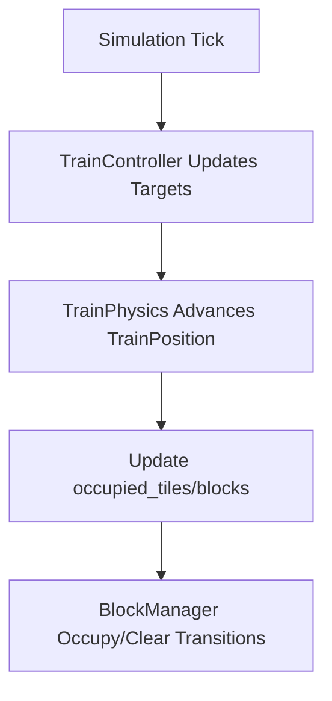
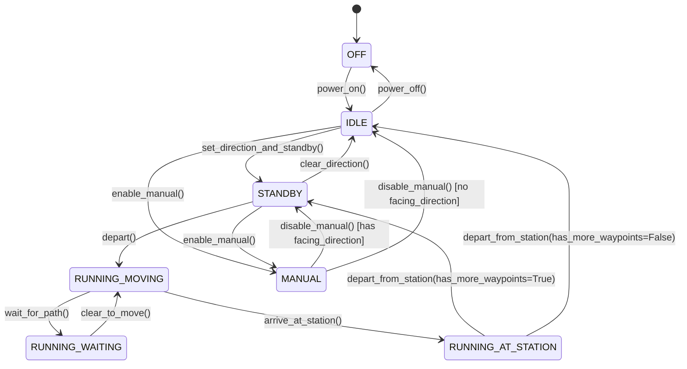
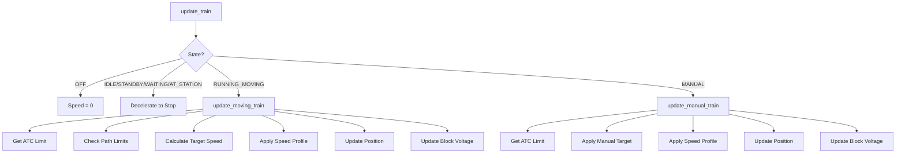

# Train Dispatch System - Technical Documentation

## Table of Contents

1. [Overview](#overview)
2. [Train Movement Between Tiles](#train-movement-between-tiles)
3. [Speed Determination](#speed-determination)
4. [Train Location State Management](#train-location-state-management)
5. [Dispatch System Components](#dispatch-system-components)
6. [Train State Machine](#train-state-machine)
7. [Component Integration](#component-integration)
8. [Performance Considerations](#performance-considerations)

---

## Overview

The train dispatch system is a comprehensive simulation of DC analog train control, integrating multiple subsystems to provide realistic train movement, speed control, and safety enforcement. The system uses a tick-based simulation loop running at configurable intervals (typically 50-100ms).

**Core Components:**
- **SimulationController** - Main simulation loop coordinator
- **RouteExecutor** - Waypoint and station arrival management
- **PathDispatcher** - Infrastructure reservation and path planning
- **TrainController** - ATC + ATO decisions and command validation
- **TrainPhysics** - Physical movement and block occupancy updates
- **BlockPowerController** - DC voltage output to track blocks
- **SpeedProfile** - Speed-to-voltage mapping and acceleration curves

**File Locations:**
- `simulation.py` - SimulationController
- `route_executor.py` - RouteExecutor
- `path_dispatcher.py` - PathDispatcher
- `train_controller.py` - TrainController (ATC + ATO)
- `train_physics.py` - TrainPhysics (movement + blocks)
- `block_power.py` - BlockPowerController
- `speed_profile.py` - SpeedProfile
- `train.py` - Train class and state machine
- `network.py` - RailwayNetwork coordinator

---

## Train Movement Between Tiles

### Overview

Trains move through the layout by following a **path** - a sequence of `(x, y, direction)` tuples representing tiles and the direction to exit each tile. Physical movement is executed by `TrainPhysics` which updates `TrainPosition` (head/tail distances and occupied tiles).

### Movement Algorithm

```python
def tick(delta_seconds):
    # 1. Convert speed to distance
    distance_cm = kmh_to_cm_per_sec(train.current_speed) * delta_seconds

    # 2. Advance head/tail along the path
    train.position = advance_train_position(train.position, distance_cm)

    # 3. Update block occupancy based on new occupied tiles
    update_block_transitions(train.position.occupied_blocks)
```

### Tile Advancement

TrainPosition stores entry edges and distances for both ends of the train. When the head crosses the current tile length, the head enters the next tile, entry/exit edges are recalculated from track geometry, and the set of `occupied_tiles`/`occupied_blocks` is refreshed.

### Path Structure

A path is a list of `(x, y, direction)` tuples:

```python
# Example path from (0,0) to (3,0) traveling east
path = [
    (0, 0, Direction.EAST),  # Start
    (1, 0, Direction.EAST),  # Continue east
    (2, 0, Direction.EAST),  # Continue east
    (3, 0, Direction.EAST),  # Destination
]

train.current_path = path
train.path_index = 0  # Currently at first position
```

### Direction Handling

The system tracks two direction concepts:

1. **`facing_direction`** - Which cab is active (which end is "front")
2. **`travel_direction`** - "forward" or "reverse" (only used in MANUAL mode)

```python
# train.py:832-848
def get_effective_direction():
    if facing_direction is None:
        return None
    
    if travel_direction == "forward":
        return facing_direction
    else:
        # Reverse: opposite of facing direction
        return facing_direction.opposite()
```

**Example:**
```
Train facing EAST, travel_direction="forward"
→ Effective direction: EAST (moving east)

Train facing EAST, travel_direction="reverse" (MANUAL mode only)
→ Effective direction: WEST (moving west, tail-first)
```

### Manual Movement (No Path)

In MANUAL mode without a path, trains use track connections to determine movement. `TrainPhysics` selects a valid exit from the current tile based on track geometry and switch state, then advances TrainPosition using the same head/tail rules as path-based movement.

---

## Speed Determination

Train speed is determined by multiple overlapping systems, with the **minimum** of all limits being applied.

### Speed Calculation Hierarchy

```
Target Speed = min(
    train.max_speed,           # Rolling stock limit
    atc_limit,                 # ATC safety limit
    path_limit,                # Signal/block limits
    profile_limit              # Speed profile curve
)
```

### 1. Base Speed Limits

```python
# simulation.py:115-118
base_target = train.max_speed  # e.g., 120 km/h
limit_speed = check_path_limits(train)
atc_limit = atc.get_speed_limit()

train.target_speed = min(base_target, atc_limit, limit_speed)
```

### 2. Path Limits (Signals & Blocks)

Immediate next-tile checks:

```python
# simulation.py:163-221
def _check_path_limits(train):
    limit_speed = train.max_speed
    
    if train.path_index + 1 < len(train.current_path):
        next_tile = train.current_path[train.path_index + 1]
        
        # Check signals at current position
        head_tile = train.position.head_tile if train.position else None
        signals = network.get_signals_at(*head_tile) if head_tile else []
        for signal in signals:
            if signal.detection_direction == train.direction:
                if signal.state == SignalState.RED:
                    limit_speed = 0  # STOP
                elif signal.state == SignalState.YELLOW:
                    limit_speed = min(limit_speed, 40)  # CAUTION
        
        # Check next tile occupancy
        if next_track.is_occupied() and next_track.occupied_by != train.train_id:
            limit_speed = 0  # STOP (collision avoidance)
    else:
        # End of path
        limit_speed = 0
    
    return limit_speed
```

### 3. ATC (Automatic Train Control)

ATC calculates safe speed based on clearance ahead using braking curves:

```python
# train_controller.py
def calculate_max_safe_speed(clearance_cm, deceleration_rate):
    # Physics: v² = 2 * a * d
    # Solve for v: v = sqrt(2 * a * d)
    
    effective_distance = clearance_cm - safety_margin_cm
    
    # Convert deceleration from km/h/s to cm/s²
    decel_cm_s2 = deceleration_rate * (100000 / 3600)
    
    # Calculate max velocity
    v_cm_s = sqrt(2 * decel_cm_s2 * effective_distance)
    
    # Convert back to km/h
    v_kmh = v_cm_s / (100000 / 3600)
    return v_kmh
```

**ATC Clearance Calculation:**

```python
# train_controller.py
def get_clearance_ahead():
    clearance = 0.0
    
    # 1. Remaining distance in current block
    clearance += remaining_distance_in_current_block()
    
    # 2. Sum blocks ahead until obstruction
    for block_id in get_blocks_ahead():
        block = network.blocks[block_id]
        
        # Stop at obstructions
        if block.occupied_by != train.train_id:
            break
        if is_signal_red_for_block(block_id):
            break
        
        # Add block length
        clearance += block.length_cm
    
    return clearance
```

**Example:**
```
Current block: 500cm remaining
Next block: 1000cm (FREE)
Block after: 1000cm (OCCUPIED)

Total clearance = 500 + 1000 = 1500cm
Max safe speed at 3 m/s² deceleration = 46.5 km/h
```

### 4. Speed Profile Application

Speed profiles control acceleration and deceleration curves:

```python
# speed_profile.py:145-179
def calculate_new_speed(current_speed, target_speed, delta_seconds):
    if current_speed < target_speed:
        # Accelerate
        speed_increase = acceleration_rate * delta_seconds
        new_speed = current_speed + speed_increase
        return min(new_speed, target_speed)
    
    elif current_speed > target_speed:
        # Decelerate
        speed_decrease = deceleration_rate * delta_seconds
        new_speed = current_speed - speed_decrease
        return max(new_speed, target_speed)
    
    else:
        # At target speed
        return current_speed
```

**Example Profile:**
```python
default_profile = SpeedProfile(
    profile_id="DEFAULT",
    acceleration_rate=2.5,      # km/h per second
    deceleration_rate=3.0,      # km/h per second
    lighting_voltage=2.0,       # Volts for stopped trains
    speed_voltage_points=[      # Speed → Voltage mapping
        (0, 2.0),               # 0 km/h = 2V (lighting)
        (20, 4.0),              # 20 km/h = 4V
        (60, 8.0),              # 60 km/h = 8V
        (120, 12.0)             # 120 km/h = 12V
    ]
)
```

### 5. Block Voltage Output

The BlockPowerController converts speed to voltage:

```python
# block_power.py:189-236
def _calculate_voltage_for_train(train, speed_profile):
    if train.state == TrainState.OFF:
        return 0.0
    
    if train.state in (IDLE, STANDBY, RUNNING_WAITING, RUNNING_AT_STATION):
        return speed_profile.lighting_voltage  # ~2V
    
    if train.state == TrainState.RUNNING_MOVING:
        return speed_profile.speed_to_voltage(train.target_speed)
    
    if train.state == TrainState.MANUAL:
        return speed_profile.speed_to_voltage(train.manual_target_speed)
```

**Voltage Interpolation:**

```python
# speed_profile.py:58-101
def speed_to_voltage(speed_kmh):
    # Find bracketing points
    for i in range(len(speed_voltage_points) - 1):
        s1, v1 = speed_voltage_points[i]
        s2, v2 = speed_voltage_points[i + 1]
        
        if s1 <= speed_kmh <= s2:
            # Linear interpolation
            ratio = (speed_kmh - s1) / (s2 - s1)
            voltage = v1 + ratio * (v2 - v1)
            return voltage
```

---

## Train Location State Management

### Position Tracking

Train location is tracked using `TrainPosition`, which stores head/tail distances and the occupied tile list:

```python
class Train:
    position: Optional[TrainPosition] = None
```

`TrainPosition` fields include:
- `end_a_tile`, `end_a_distance_cm`, `end_a_entry_edge`
- `end_b_tile`, `end_b_distance_cm`, `end_b_entry_edge`
- `leading_end` and `facing_direction`
- `occupied_tiles` and `occupied_blocks`

**Example:**
```
Train head at tile (5, 3), tail at tile (4, 3)
end_a_distance_cm = 900.0 (head near exit edge)
end_b_distance_cm = 200.0 (tail near entry edge)
occupied_tiles = [(5, 3), (4, 3)]
```

### Block Occupancy

TrainPhysics updates `BlockManager` based on the head/tail transitions in TrainPosition:
- `occupy_block()` when the head enters a new block
- `clear_block()` when the tail clears a block

Block state transitions are enforced by the `BlockManager` state machine:
`FREE → RESERVED → OCCUPIED → CAUTION → FREE`

### Multi-Block Occupancy

Long trains can occupy multiple blocks simultaneously. The set of occupied blocks
is derived from `TrainPosition.occupied_tiles` and updated each tick.

### Reserved Blocks

The PathDispatcher reserves blocks ahead of the train:

```python
# path_dispatcher.py:741-837
def create_path(start_block_id, end_block_id, train_id):
    # 1. Find path through blocks
    path_tiles = pathfinding_algorithm(start_block, end_block)
    
    # 2. Reserve all blocks in path
    for block_id in block_path:
        block = network.blocks[block_id]
        block.reserve_for_path(path_id)
    
    # 3. Assign to train
    train.assigned_path_id = path_id
    train.reserved_blocks = block_path
    
    return path
```

### Position Update Flow



---

## Dispatch System Components

### PathDispatcher

Manages infrastructure reservations:

```python
# path_dispatcher.py:60-103
class PathDispatcher:
    def create_path(start_block_id, end_block_id, train_id):
        # 1. Pathfinding
        block_path = find_block_path(start_block, end_block)
        
        # 2. Check availability
        for block_id in block_path:
            if not block.is_available():
                return PathResult(success=False, error="Block occupied")
        
        # 3. Reserve blocks
        for block_id in block_path:
            block.reserve_for_path(path_id, train_id)
        
        # 4. Set switch positions
        for switch_pos in required_switches:
            set_switch(switch_pos)
        
        return PathResult(success=True, path=path)
```

**Path Lifecycle:**

1. **Creation** - `create_path()` reserves blocks
2. **Active** - Train travels along path
3. **Advancement** - `on_train_advances()` releases blocks behind train
4. **Completion** - `complete_path()` releases all blocks

**Note:** Currently, `SimulationController` does NOT call dispatcher lifecycle hooks, leading to potential reservation leaks (see Oracle's analysis).

### RouteExecutor

Manages waypoint navigation and station stops:

```python
# route_executor.py:82-138
def update(delta_seconds):
    for train in network.trains.values():
        if train.assigned_route_id:
            route = network.routes[train.assigned_route_id]
            
            if train.state == TrainState.STANDBY:
                # Try to depart to next waypoint
                _try_depart_to_waypoint(train, route)
            
            elif train.state == TrainState.RUNNING_MOVING:
                # Check if arrived at waypoint
                _check_waypoint_arrival(train, route)
            
            elif train.state == TrainState.RUNNING_AT_STATION:
                # Check if dwell time complete
                _check_dwell_complete(train, route)
```

**Waypoint Arrival Detection:**

```python
# route_executor.py:424-449
def _is_train_at_station(train, station_id):
    station = network.stations[station_id]
    
    # NEW: Check if at TARGET tile (last tile in travel direction)
    target_tile = _get_target_station_tile(train, station)
    return train.position and train.position.head_tile == target_tile

def _get_target_station_tile(train, station):
    # Sort station tiles by travel direction
    # Return furthest tile in direction of travel
    
    if travel_direction == Direction.EAST:
        return max(station.positions, key=lambda p: p[0])  # Easternmost
    elif travel_direction == Direction.WEST:
        return min(station.positions, key=lambda p: p[0])  # Westernmost
    elif travel_direction == Direction.NORTH:
        return max(station.positions, key=lambda p: p[1])  # Northernmost
    elif travel_direction == Direction.SOUTH:
        return min(station.positions, key=lambda p: p[1])  # Southernmost
```

**Dwell Time Management:**

```python
# route_executor.py:311-371
def _check_dwell_complete(train, route):
    waypoint = route.get_current_waypoint()
    time_at_station = simulation_time - arrived_at_station_time
    
    if waypoint.should_depart(time_at_station, route_start_time, simulation_time):
        # Advance to next waypoint
        next_waypoint = route.advance_to_next_waypoint()
        
        if next_waypoint:
            # More waypoints - return to STANDBY
            train.depart_from_station(has_more_waypoints=True)
        else:
            # Route complete
            train.depart_from_station(has_more_waypoints=False)
            route.deactivate()
```

---

## Train State Machine

### State Enumeration

```python
# enums.py:91-111
class TrainState(Enum):
    OFF = "off"                          # Powered off
    IDLE = "idle"                        # Powered on, no direction
    STANDBY = "standby"                  # Direction set, ready to depart
    RUNNING_MOVING = "running_moving"    # Actively moving
    RUNNING_WAITING = "running_waiting"  # Stopped, waiting for clearance
    RUNNING_AT_STATION = "running_at_station"  # At station, dwelling
    MANUAL = "manual"                    # User control mode
```

### State Transitions



### State Transition Methods

```python
# train.py:854-1125
# Power control
def power_on(): OFF → IDLE
def power_off(): any → OFF (if stopped)

# Direction control
def set_standby(direction): IDLE → STANDBY
def clear_direction(): STANDBY → IDLE (if stopped)
def turn_around(): Flip facing_direction (if stopped)

# Manual control
def enable_manual(): IDLE/STANDBY → MANUAL
def disable_manual(): MANUAL → STANDBY/IDLE
def set_manual_speed(speed): Set manual_target_speed (MANUAL only)
def set_travel_direction("forward"/"reverse"): MANUAL only

# Running control
def depart(): STANDBY → RUNNING_MOVING
def wait_for_path(reason): RUNNING_MOVING → RUNNING_WAITING
def clear_to_move(): RUNNING_WAITING → RUNNING_MOVING
def arrive_at_station(): RUNNING_MOVING → RUNNING_AT_STATION
def depart_from_station(has_more): RUNNING_AT_STATION → STANDBY/IDLE
```

### State Machine Rules

**Stopped-Only Operations:**
- `power_off()` - Can only power off when `current_speed < 0.1 km/h`
- `turn_around()` - Can only flip direction when stopped
- `clear_direction()` - Can only clear when stopped
- `enable_manual()` / `disable_manual()` - Only when stopped

**State-Specific Behaviors:**

```python
# simulation.py:73-97
def _update_train(train, delta_seconds):
    if train.state == TrainState.OFF:
        train.current_speed = 0.0
        return
    
    if train.state in (IDLE, STANDBY, RUNNING_WAITING, RUNNING_AT_STATION):
        # Decelerate to stop
        _decelerate_to_stop(train, delta_seconds)
        power_controller.update_for_train(train)
        return
    
    if train.state == TrainState.RUNNING_MOVING:
        # Full speed control with ATC
        _update_moving_train(train, delta_seconds)
        return
    
    if train.state == TrainState.MANUAL:
        # User-controlled speed
        _update_manual_train(train, delta_seconds)
        return
```

---

## Component Integration

### Simulation Loop

```python
# simulation.py:50-57
def update(delta_seconds):
    simulation_time += delta_seconds
    
    # 1. Update route execution (waypoint logic)
    route_executor.update(delta_seconds)
    
    # 2. Update each train
    for train in network.trains.values():
        _update_train(train, delta_seconds)
```

### Train Update Flow



### Moving Train Update Detail

```python
# simulation.py:98-139
def _update_moving_train(train, delta_seconds):
    # 1. Check if path exists
    if not train.current_path:
        train.target_speed = 0.0
        _decelerate_to_stop(train, delta_seconds)
        return
    
    # 2. Get speed limits
    atc = _get_or_create_atc(train)
    atc_limit = atc.get_speed_limit()
    path_limit = _check_path_limits(train)
    
    # 3. Calculate target speed (minimum of all limits)
    train.target_speed = min(train.max_speed, atc_limit, path_limit)
    
    # 4. Apply speed profile (acceleration/deceleration)
    profile = _get_speed_profile(train)
    train.current_speed = profile.calculate_new_speed(
        train.current_speed, train.target_speed, delta_seconds
    )
    
    # 5. Update block voltage
    power_controller.update_for_train(train)
    
    # 6. Update position + blocks
    train_physics.tick(delta_seconds)
    
    # 7. Check if stopped (transition to WAITING)
    if train.target_speed <= 0 and train.is_stopped():
        train.state = TrainState.RUNNING_WAITING
        train.wait_reason = _get_wait_reason(train)
```

### Full Integration Example

Real scenario from `demo_main.py`:

```python
# 1. Setup network
network = RailwayNetwork()

# 2. Create infrastructure
network.create_block_with_tracks("BLOCK_MAIN", [(0,0), (1,0), (2,0)])
station = network.add_station(1, 0, "Main Station")
signal = network.create_signal(0, 0, SignalType.AUTOMATIC, direction='E')

# 3. Create train
train = Train(train_id="TRAIN_01", max_speed=80.0)
network.add_train(train)
network.place_train(train, 0, 0, Direction.EAST)

# 4. Setup simulation
sim_controller = SimulationController(network)

# 5. Create route (travel plan)
route = Route(route_id="ROUTE_01")
route.add_waypoint(Waypoint(station_id="Main Station", dwell_time_sec=30.0))
network.routes[route.route_id] = route

# 6. Activate route
sim_controller.route_executor.activate_route(train, route)
# This sets train to STANDBY

# 7. Simulation loop (50Hz = 20ms per tick)
while True:
    sim_controller.update(delta_seconds=0.02)
    sleep(0.02)

# Execution flow:
# Tick 1: RouteExecutor sees train in STANDBY
#         → Requests path from PathDispatcher
#         → Reserves blocks
#         → Sets train.current_path
#         → Calls train.depart() → RUNNING_MOVING
# 
# Tick 2-N: SimulationController updates train position
#           → ATC calculates safe speed
#           → Speed profile applies acceleration
#           → Train moves through tiles
#           → Block occupancy updated
# 
# Tick M: RouteExecutor detects train at station target tile
#         → Calls train.arrive_at_station() → RUNNING_AT_STATION
#         → Starts dwell timer
# 
# Tick M+N: Dwell time complete
#           → RouteExecutor advances waypoint
#           → Calls train.depart_from_station() → STANDBY
#           → Cycle repeats for next waypoint
```

---

## Performance Considerations

### Tick Rate

Recommended: **20-50ms per tick** (20-50 Hz)

```python
# Faster ticks = smoother movement but higher CPU
# Slower ticks = lower CPU but jerky movement

# Good balance: 50ms (20 Hz)
TICK_INTERVAL = 0.05  # 50ms

while running:
    start_time = time.time()
    
    sim_controller.update(TICK_INTERVAL)
    
    elapsed = time.time() - start_time
    sleep_time = max(0, TICK_INTERVAL - elapsed)
    time.sleep(sleep_time)
```

### ATC Calculation Caching

ATC clearance calculation can be expensive. Cache when possible:

```python
# train_controller.py
_cached_clearance: float = 0.0  # Cached per tick
_cached_speed_limit: float = 0.0
```

### Path Reuse

Avoid recalculating paths:

```python
# PathDispatcher maintains active paths
# Reuse path if train destination hasn't changed
if train.assigned_path_id and path.end_block == destination_block:
    # Reuse existing path
    pass
else:
    # Create new path
    path = dispatcher.create_path(start, destination, train_id)
```

### Block Occupancy Updates

Block state changes are centralized in `block_manager.py`. `TrainPhysics` should call `BlockManager` when the train head enters a new block and when the train tail clears a block.

**Recommended Pattern:**

```python
def on_train_enters_block(network, block_id, train_id):
    """Called when train head enters a new block"""
    network.block_manager.occupy_block(block_id, train_id)

def on_train_leaves_block(network, block_id, train_id):
    """Called when train tail clears a block"""
    network.block_manager.clear_block(block_id)
```

### Memory Usage

**Per Train:**
- Position: ~40 bytes
- Path: ~16 bytes × path_length
- ATC instance: ~200 bytes
- State: ~100 bytes

**For 100 trains:** ~50KB per train = ~5MB total (negligible)

### CPU Bottlenecks

**Most expensive operations:**

1. **ATC clearance calculation** - O(blocks_ahead × signals)
2. **Pathfinding** - O(blocks²) using A*
3. **Signal state calculation** - O(signals × monitored_blocks)

**Optimization strategies:**

```python
# 1. Lazy ATC calculation (only when train moving)
if train.state == TrainState.RUNNING_MOVING:
    atc_limit = atc.get_speed_limit()
else:
    atc_limit = 0.0  # Don't calculate for stopped trains

# 2. Path caching (reuse paths for same start/end)
path_cache = {}
cache_key = (start_block, end_block)
if cache_key in path_cache:
    path = path_cache[cache_key]

# 3. Signal batch updates (update all signals every N ticks)
if tick_count % 5 == 0:
    update_all_signal_states()
```

---

## Conclusion

The train dispatch system integrates multiple components to provide realistic train simulation:

- **Movement** - Tick-based position updates with tile advancement
- **Speed Control** - Multi-layered speed limiting (ATC, signals, profiles)
- **State Management** - Robust state machine with safety transitions
- **Dispatch** - Infrastructure reservation and route planning
- **Safety** - Block occupancy, signal protection, collision avoidance

**Key Integration Points:**
1. SimulationController coordinates all systems
2. RouteExecutor handles high-level navigation
3. PathDispatcher manages infrastructure
4. TrainController provides safety layer
5. BlockPowerController outputs physical voltages

**Future Enhancements:**
- Complete multi-block occupancy implementation
- Integrate PathDispatcher lifecycle hooks with simulation loop
- Implement real-time performance monitoring

**Recently Completed:**
- Speed profile REST API (`/api/speed-profiles` CRUD endpoints)
